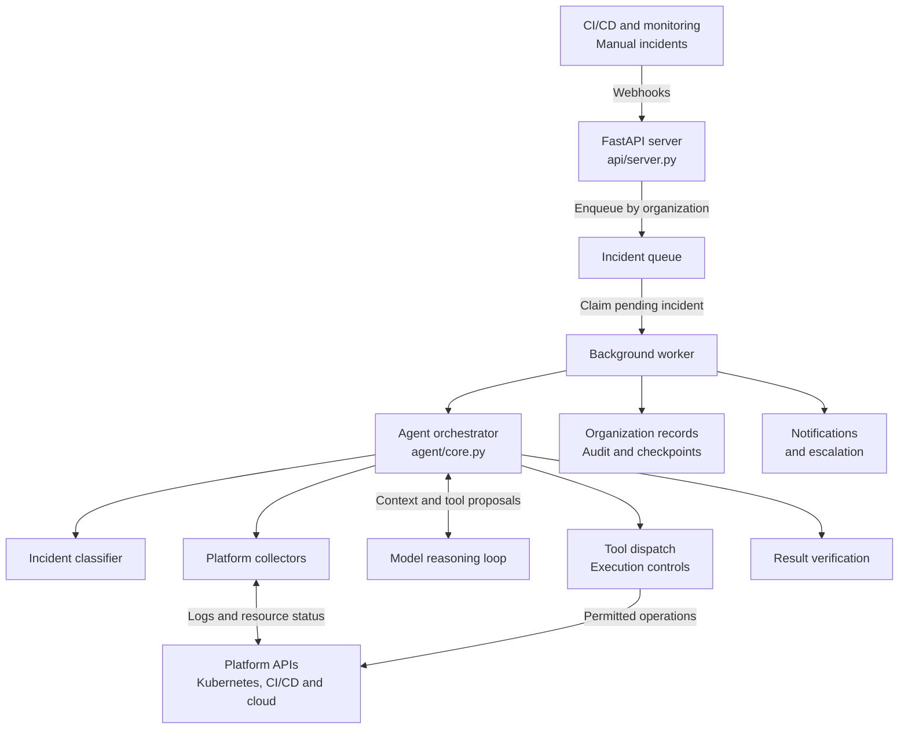
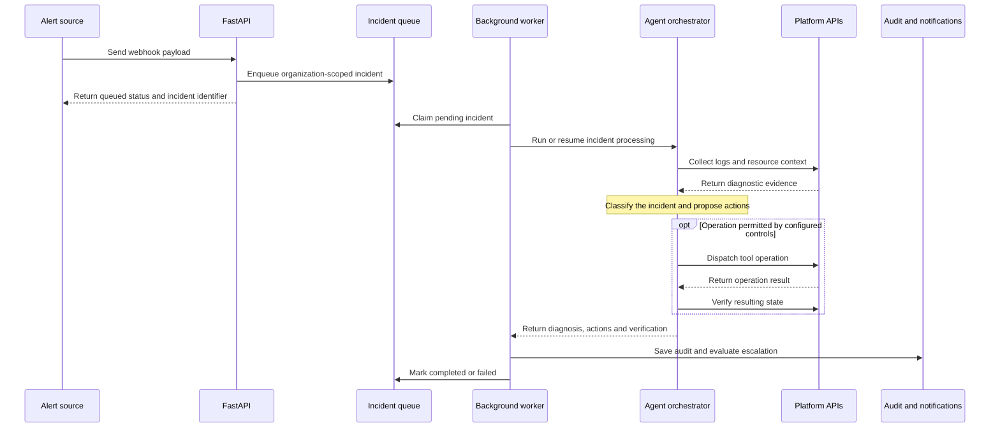
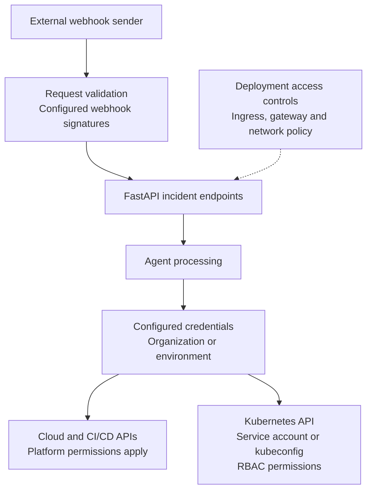
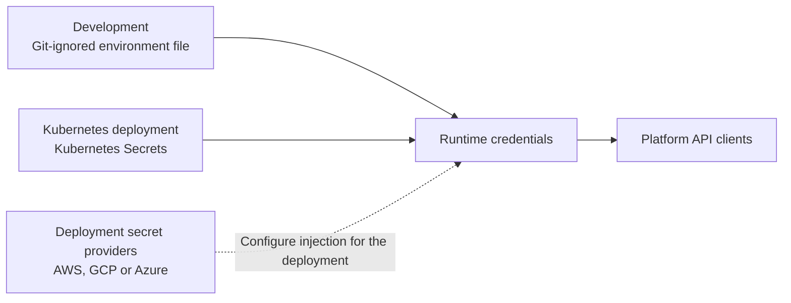

# Architecture

This guide describes the incident-processing components, their data flow, and the boundaries between the agent and connected platforms.

## System Overview

The service accepts incident webhooks, queues work by organization, and coordinates diagnosis and configured tool operations through a background worker.

## High-Level Architecture



The queue and worker are part of the API service. Platform calls originate from collectors and tools; the diagram does not imply separate deployed services for every component. When several API processes share a host and lock file, only the process that holds the background lock polls the queue and runs retention. The lock is per host; replicas on separate hosts can each run a queue loop. Correctness across hosts comes from the conditional claim: a pending incident is claimed by atomically creating its processing record only if that record is not already stored.

## Core Components

### 1. API Gateway (api/server.py)

**Purpose**: Entry point for all external events

**Key Features**:
- FastAPI-based REST API
- Webhook endpoints for various platforms
- Health and audit endpoints
- Request validation

**Endpoints**:
- `POST /webhook/github` - GitHub Actions webhooks
- `POST /webhook/gitlab` - GitLab CI webhooks
- `POST /webhook/alertmanager` - Prometheus alerts
- `POST /webhook/manual` - Manual incident triggers
- `GET /health` - Health check
- `GET /audit` - Audit log retrieval

### 2. Agent Orchestrator (agent/core.py)

**Purpose**: Central coordination of incident response

**Responsibilities**:
- Incident classification
- Context collection
- AI interaction loop
- Tool execution
- Result verification

**AI Loop**:
```python
while not resolved and iterations < MAX_AGENT_STEPS:
    1. Send context + available tools to Claude
    2. Receive analysis and tool calls
    3. Execute tool calls (with approval if needed)
    4. Collect results
    5. Send results back to Claude
    6. Repeat until resolved or limit reached
```

### 3. Classifier (agent/classifier.py)

**Purpose**: Identify incident type from alert data

**Classification Types**:
- `k8s` - Kubernetes issues
- `cicd` - CI/CD pipeline failures
- `docker` - Container build issues
- `server` - Server/VM issues
- `argocd` - GitOps deployment issues
- `cloud_aws` - AWS resource issues
- `cloud_gcp` - GCP resource issues
- `cloud_azure` - Azure resource issues

**Classification Logic**:
```python
def classify_issue(incident_data: dict) -> str:
    # Keyword-based classification
    # Checks message content, labels, and source
    # Returns issue type or "unknown"
```

### 4. Collectors (collectors/)

**Purpose**: Gather context-specific information for incidents

Each collector implements:
```python
class Collector:
    def collect(self, incident_data: dict) -> dict:
        """
        Returns:
        {
            "logs": [...],
            "metadata": {...},
            "recent_changes": [...],
            "status": "..."
        }
        """
```

**Available Collectors**:
- `K8sCollector` - Pod logs, events, manifests
- `GitHubCollector` - Workflow logs, job outputs
- `GitLabCollector` - Pipeline logs, job traces
- `JenkinsCollector` - Build logs, console output
- `ArgoCDCollector` - App status, sync history
- `AWSCollector` - CloudWatch logs, resource status
- `GCPCollector` - Cloud Logging, resource status
- `AzureCollector` - Activity logs, resource status

During CI context collection, failed Docker build logs with classic `Step n[/m] :`
markers, BuildKit `#n [i/j]` step lines, or `failed to solve:` are parsed by
`collectors/docker.py`'s `parse_build_error`. The first
matching log supplies `docker_build_error` in the incident context given to the
model, containing the parser's failing step line, error lines, and raw log tail.
The failing step is the `#N [i/j]` step line whose `#N ERROR` line reports the
failure, or the last step line before the first error line. Log lines may carry
a GitHub Actions timestamp prefix, which the step matchers tolerate and strip
from the reported step. Non-Docker logs, Docker logs without error lines, and
collector failures do not add `docker_build_error`.

### 5. Tools (tools/)

**Purpose**: Execute actions to remediate incidents

Each tool implements:
```python
def tool_function(params: dict, dry_run: bool = True) -> dict:
    """
    Returns:
    {
        "status": "success" | "failed",
        "message": "...",
        "dry_run": bool
    }
    """
```

**Tool Categories**:

**Kubernetes Tools** (`k8s_tools.py`):
- `apply_k8s_manifest` - Apply configuration
- `restart_pod` - Restart a pod
- `scale_deployment` - Scale replicas
- `rollback_deployment` - Rollback to previous version

**CI/CD Tools** (`cicd_tools.py`):
- `retry_pipeline` - Retry failed pipeline
- `create_merge_request` - Create MR/PR with fix
- `cancel_pipeline` - Cancel running pipeline

**Cloud Tools** (`cloud_tools.py`):
- `restart_cloud_service` - Restart cloud service
- `scale_cloud_service` - Scale cloud resources
- `fetch_cloud_logs` - Get service logs

**ArgoCD Tools** (`argocd_tools.py`):
- `sync_argocd_app` - Sync application
- `rollback_argocd_app` - Rollback deployment

**Git Tools** (`github_tools.py`):
- `create_github_pr` - Create pull request
- `update_file` - Update file with fix

**Notification Tools** (`notify.py`):
- `send_slack_notification` - Send Slack message

**PagerDuty Tools** (`pagerduty_tools.py`):
- `create_incident` - Create PagerDuty incident when `ESCALATION_CHANNELS`
  includes `pagerduty`

### 6. Safe Executor (tools/executor.py)

**Purpose**: Ensure all command executions are safe

**Safety Mechanisms**:

1. **Command Whitelist**:
```python
ALLOWED_COMMANDS = [
    'kubectl', 'git', 'curl', 'echo',
    # Dangerous commands blocked
]
```

2. **Dry-Run Mode**:
```python
if dry_run:
    return {"status": "success", "dry_run": True, "message": "Would execute..."}
```

3. **Approval Gates**:
```python
if not AUTO_APPLY and is_destructive_action():
    request_approval_from_slack()
    wait_for_response()
```

4. **Audit Logging**:
```python
audit_log.append({
    "timestamp": now(),
    "action": action_name,
    "params": params,
    "result": result,
    "ai_reasoning": reasoning
})
```

## Data Flow

### Incident Response Flow



## Plugin Architecture

The system is designed for easy extension:

### Adding a New Collector

```python
# collectors/my_platform.py
class MyPlatformCollector:
    def __init__(self, api_token: str):
        self.client = MyPlatformClient(token=api_token)
    
    def collect(self, incident_data: dict) -> dict:
        logs = self.client.get_logs(incident_data['resource_id'])
        return {
            "logs": logs,
            "metadata": {...}
        }

# Register in agent/core.py
self.collectors['my_platform'] = MyPlatformCollector()
```

### Adding a New Tool

```python
# tools/my_platform_tools.py
def restart_my_service(service_id: str, dry_run: bool = True) -> dict:
    if dry_run:
        return {"status": "success", "dry_run": True}
    
    # Execute restart
    return {"status": "success", "dry_run": False}

# Register in agent/core.py
self.tools.append({
    "name": "restart_my_service",
    "description": "Restarts a service",
    "input_schema": {...}
})
```

## Security Architecture

### Authentication & Authorization



Inbound controls vary by endpoint and configuration. This diagram does not claim that API-token validation or an IP allowlist is implemented for every route; review the [security guarantees](SECURITY_GUARANTEES.md) and deployment configuration.

### Secrets Management



## Scalability

### Horizontal Scaling

```yaml
# Multiple replicas for high availability
apiVersion: apps/v1
kind: Deployment
spec:
  replicas: 3
  # Agent instances share audit log via PVC
```

### Stateless Design

- No local state (except audit log)
- All context fetched on-demand
- Can restart without data loss

### Rate Limiting

```python
# Prevent API abuse
from slowapi import Limiter

limiter = Limiter(key_func=get_remote_address)
app.state.limiter = limiter

@app.post("/webhook/manual")
@limiter.limit("10/minute")
async def manual_webhook(...):
    pass
```

## Monitoring & Observability

### Metrics

```python
# Prometheus metrics
from prometheus_client import Counter, Histogram

incident_counter = Counter('agent_incidents_total', 'Total incidents')
tool_call_duration = Histogram('agent_tool_call_duration_seconds', 'Tool execution time')
```

### Logging

```python
import structlog

logger = structlog.get_logger()
logger.info("incident_received", 
            incident_type=issue_type,
            namespace=namespace,
            severity=severity)
```

### Tracing (Optional)

```python
# OpenTelemetry integration
from opentelemetry import trace

tracer = trace.get_tracer(__name__)

with tracer.start_as_current_span("agent_loop"):
    # Agent logic
    pass
```

## Deployment Patterns

### Pattern 1: Kubernetes Sidecar

```yaml
# Deploy agent as sidecar in app pods
spec:
  containers:
  - name: app
    image: myapp:latest
  - name: devops-agent
    image: devops-ai-agent:latest
```

### Pattern 2: Centralized Service

```yaml
# Single agent instance for entire cluster
apiVersion: apps/v1
kind: Deployment
metadata:
  name: devops-agent
  namespace: devops-agent
```

### Pattern 3: Multi-Cluster

```yaml
# Agent in management cluster
# Monitors multiple workload clusters
# Uses multiple kubeconfigs
```

## Error Handling

### Error Hierarchy

```
AgentException (base)
├─ CollectorException
│  ├─ K8sCollectorException
│  ├─ GitHubCollectorException
│  └─ CloudCollectorException
├─ ToolExecutionException
│  ├─ CommandBlockedException
│  ├─ ApprovalTimeoutException
│  └─ ExecutionFailedException
└─ AIException
   ├─ TokenLimitException
   └─ APIException
```

### Retry Logic

```python
@retry(
    stop=stop_after_attempt(3),
    wait=wait_exponential(multiplier=1, min=4, max=10)
)
def fetch_logs():
    # Retry on transient failures
    pass
```

## Performance Considerations

### Caching

```python
from functools import lru_cache

@lru_cache(maxsize=100)
def get_pod_manifest(namespace, pod_name):
    # Cache pod manifests for 5 minutes
    pass
```

### Async Operations

```python
import asyncio

async def collect_all_contexts():
    tasks = [
        collector1.collect_async(),
        collector2.collect_async(),
        collector3.collect_async()
    ]
    return await asyncio.gather(*tasks)
```

## Testing Strategy

### Unit Tests
- Test individual collectors
- Test individual tools
- Mock external dependencies

### Integration Tests
- Test full agent loop
- Use test data and mocks
- Verify audit logging

### End-to-End Tests
- Deploy to staging
- Trigger real incidents
- Verify resolutions

## Future Enhancements

1. **Multi-Agent Collaboration**
   - Specialized agents for different domains
   - Agent-to-agent communication

2. **Learning System**
   - Learn from past incidents
   - Build knowledge base
   - Improve accuracy over time

3. **Predictive Analytics**
   - Predict incidents before they occur
   - Proactive remediation

4. **Advanced Orchestration**
   - Workflow engine for complex remediations
   - Parallel action execution

## References

- [FastAPI Documentation](https://fastapi.tiangolo.com/)
- [Anthropic Claude API](https://docs.anthropic.com/)
- [Kubernetes API](https://kubernetes.io/docs/reference/)
- [GitHub API](https://docs.github.com/en/rest)
