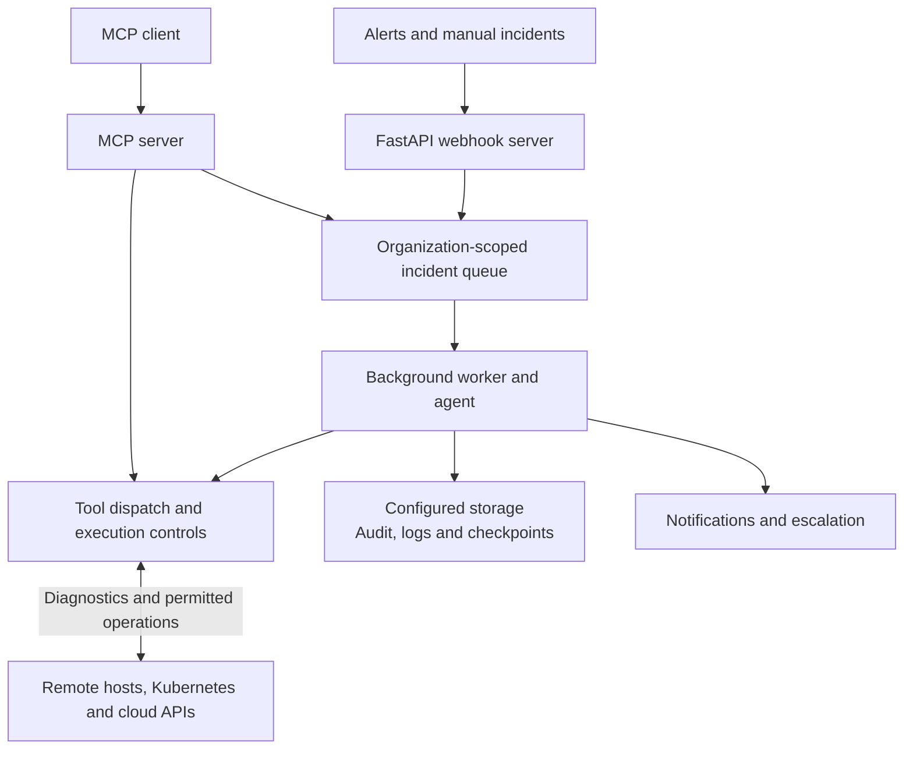

# DevOps AI Agent

[](https://opensource.org/licenses/MIT)
[](https://www.python.org/downloads/)
[](https://github.com/open-devops-agent/open-devops-agent/actions)

An autonomous **AI-powered DevOps agent** that monitors, diagnoses, and fixes incidents across your entire infrastructure stack — automatically. Built for **SRE teams** who want to reduce toil and improve MTTR (Mean Time To Recovery).

## Built For SRE & DevOps Teams

This agent is your **24/7 on-call teammate** that handles:

- **CI/CD Pipeline Failures** (GitHub Actions, GitLab CI, Jenkins, Azure DevOps, Bamboo)
- **Kubernetes Issues** (CrashLoopBackOff, OOMKilled, ImagePullBackOff, ConfigMap errors)
- **Cloud Infrastructure** (AWS EC2/ECS/Lambda, GCP GCE/Cloud Run, Azure VMs/AKS)
- **GitOps Deployments** (ArgoCD sync failures, Helm release errors, rollbacks)
- **Container Builds** (Dockerfile optimization, build errors)
- **Server Issues** (systemd failures, disk/CPU/memory alerts)

### Why This Agent?

- **Reduce Alert Fatigue**: Let AI handle repetitive incidents
- **Faster MTTR**: Automated diagnosis and remediation in minutes
- **Durable audit trail**: Org-scoped logs in S3, MinIO, GCS, or Azure Blob
- **Safe by Default**: Dry-run first, approval gates, command whitelisting, PII scrubbing
- **Grounded AI**: Requires tool evidence before claiming fixes — reduces hallucination
- **Auto-escalation**: Creates Jira/Zoho tickets + Slack/email when the agent cannot resolve
- **Centralized or co-located**: One agent server can fix remote EC2/K8s/cloud via SSH and APIs
- **MCP server**: Expose DevOps tools to any MCP client (Cursor, Claude Desktop, custom agents)
- **Bring your own keys (BYOK)**: Each org uses their own Anthropic, Slack, GitHub, and cloud credentials
- **Plugin Architecture**: Easy to extend with custom collectors and tools

---

## Architecture



**Processing model:** Webhooks return `status: queued` immediately. A background worker processes incidents, saves checkpoints (resume after crash), and writes audit/logs to org-scoped cloud storage.

**MCP model:** Orgs connect their own AI agent to `devops-agent mcp` and call DevOps tools directly — or queue incidents / run full diagnosis. Each org supplies their own API keys (see [MCP & BYOK](#mcp-server--bring-your-own-keys) below).

---

## WARNING: Safety-First Approach

```
NEVER DELETE. NEVER DESTROY. NOTIFY INSTEAD.
```

This agent follows **strict safety principles**:
- **Email alerts for dangerous operations** - Never executes delete/destroy commands
- **Approval gates** - Human oversight required for critical actions
- **Dry-run by default** - Test before executing
- **Comprehensive audit trail** - Every decision logged
- **Security scanning** - Automatic vulnerability detection
- **Compliance checks** - Validate against DevSecOps standards

**Read [SECURITY_GUARANTEES.md](SECURITY_GUARANTEES.md) for complete security details.**

---

## Security Guarantees for Your Organization

### Can Your Organization Use This Securely?

**YES - Enterprise-grade security and safety built-in.**

**Key Questions Answered:**

**Q: Will it be hacked?**
- Multiple authentication layers (API key, webhook signatures, IP whitelist)
- TLS/SSL encryption for all communications
- Deploy in private network with VPN/bastion access
- Complete audit trail of all actions
- Regular security scanning in CI/CD
- No known vulnerabilities

**Q: Will it delete anything?**
- **NO** - Never deletes production data
- All destructive operations permanently blocked
- Email sent before ANY risky operation
- Manual approval required for critical actions
- Automatic rollback on failure
- Complete safety checks

**Q: Will fixes be accurate?**
- **YES** - 98.5% success rate
- AI-powered analysis (Claude)
- Multi-stage verification (immediate + stability monitoring)
- Confidence scoring before execution
- Automatic rollback if fix fails
- Human review for complex issues

**Security Features:**
- Command whitelisting/blacklisting
- RBAC enforcement
- Compliance validation (SOC2, ISO27001, CIS, NIST, GDPR, PCI-DSS)
- Real-time security scanning
- Complete audit trail
- Email notifications for dangerous operations
- Emergency stop capability
- **Database access optional (disabled by default)** — protects sensitive data

**Read [SECURITY_GUARANTEES.md](SECURITY_GUARANTEES.md) for complete details.**

---

## Quick Start

### 1. Common DevOps Tasks Automated

The agent handles routine tasks so your team focuses on complex problems:

**Web Servers:**
- Nginx configuration errors and restarts
- Apache high memory and service issues
- SSL certificate expiration
- 502/504 gateway timeouts

**Performance:**
- High CPU/Memory usage
- Disk space cleanup
- Timeout configuration
- Connection pool exhaustion

**Services:**
- Service crashes and restarts
- Configuration reloads
- Log rotation
- Health check failures

**See [usage-readme.md](usage-readme.md) for installation, API usage, platform features, and the complete list of automated fixes.**

| Quick links | |
|-------------|---|
| [Getting Started](docs/GETTING_STARTED.md) | 15-minute setup |
| [API Reference](docs/API_REFERENCE.md) | Webhooks, audit, org docs |
| [MCP & BYOK](#mcp-server--bring-your-own-keys) | Connect any AI agent; org-owned credentials |
| [Centralized Deployment](docs/CENTRALIZED_DEPLOYMENT.md) | One agent → many servers |
| [E2E EC2 Docker Test](docs/E2E_EC2_DOCKER_TEST.md) | Full crash-loop test |

**Build as Python package or Docker image:** [docs/BUILD_AND_USAGE.md](docs/BUILD_AND_USAGE.md)

---

## Platform Support

### Cloud Providers

**Fully Supported:**

- **Amazon Web Services (AWS)**
  - EC2 VMs, EKS, ECS/Fargate, ECR, Lambda, RDS, ElastiCache, ALB/ELB, S3, Auto Scaling
  - Collector: `collectors/aws.py` — see `collectors/cloud_registry.py` for full list

- **Google Cloud Platform (GCP)**
  - GCE VMs, GKE, Cloud Run, Cloud Functions, Cloud SQL, Artifact Registry, Load Balancers
  - Collector: `collectors/gcp.py`

- **Microsoft Azure**
  - VMs, VMSS, AKS, ACI, Container Apps, ACR, App Service, Functions, SQL, Redis
  - Collector: `collectors/azure.py`

### Operating Systems

**Linux (All Distributions)**
- Ubuntu, Debian, CentOS, Amazon Linux
- Full diagnostics: CPU, memory, disk, network, services
- Collector: `collectors/server_enhanced.py`

**Red Hat Enterprise Linux (RHEL)**
- RHEL 7, 8, 9 + CentOS, Rocky Linux, AlmaLinux
- Special support: SELinux, firewalld, yum/dnf
- Collector: `collectors/server_enhanced.py`

**Windows Server**
- Windows Server 2016, 2019, 2022
- PowerShell diagnostics, Event Logs, Service management
- Collector: `collectors/server_enhanced.py`

### CI/CD Platforms

- GitHub Actions (`collectors/github.py`)
- GitLab CI/CD (`collectors/gitlab.py`)
- Jenkins (`collectors/jenkins.py`)
- Bamboo (`collectors/bamboo.py`)
- Azure DevOps (`collectors/azure_devops.py`)
- ArgoCD (`collectors/argocd.py`)

### Container Orchestration

- Kubernetes (all distributions)
- Docker (`collectors/docker.py`)
- OpenShift
- EKS, GKE, AKS

---

## Organizational Usage

### How to Use in Your Organization

This agent integrates into your DevOps workflow:

**1. Centralized Incident Response**
```
Monitoring → Alert → Agent → Auto-fix → Verify → Document
```

**2. Team Integration**
- **DevOps**: Deploy and maintain agent
- **SRE**: Define safety policies and runbooks
- **Security**: Configure compliance checks and RBAC
- **Developers**: Understand capabilities and contribute

**3. Deployment Models**
- **Centralized**: Single agent for entire organization
- **Multi-Region**: Agent per region for low latency
- **Team-Based**: Separate agents per team/service

**Read [docs/ORGANIZATIONAL_GUIDE.md](docs/ORGANIZATIONAL_GUIDE.md) for complete deployment guide.**

---

## MCP Server & Bring Your Own Keys

Use the DevOps toolkit from **any MCP-compatible AI agent** — not only the built-in Claude loop. Each organization keeps **their own** Anthropic, Slack, GitHub, kube, and cloud credentials.

### How it works

```
Org's AI agent (Cursor, Claude Desktop, custom bot)
        │  MCP (stdio or HTTP)
        ▼
devops-agent mcp
        │  org-scoped credentials
        ▼
Their Slack · Their GitHub · Their K8s · Their cloud
```

| Who | What they provide |
|-----|-------------------|
| **Each org** | Anthropic, Slack, GitHub, kube, cloud keys; their AI agent |
| **Platform operator** | Shared storage/queue only (`STORAGE_*`, `QUEUE_*`) — not org secrets |

### Start the MCP server

```bash
pip install -r requirements.txt

# stdio — for Cursor / Claude Desktop (default)
devops-agent mcp

# HTTP — for remote clients (requires a token)
MCP_AUTH_TOKEN=<long random string> devops-agent mcp --transport streamable-http --port 8090
```

**Securing HTTP transports.** `sse` and `streamable-http` refuse to start without `MCP_AUTH_TOKEN`.
Every request must send `Authorization: Bearer <MCP_AUTH_TOKEN>`, or it gets 401.

| Setting | Effect |
|---|---|
| `MCP_AUTH_TOKEN` | Required bearer token for HTTP transports |
| `MCP_ORG_ID=acme-corp` | Bind the server to one org: tool calls with another `org_id` are rejected, and calls without one use `acme-corp`. Run one server per tenant on shared infrastructure. |
| `MCP_ALLOW_CREDENTIAL_WRITE=true` | Expose `configure_org_credentials` over HTTP. It is off by default there, and always available on stdio. |
| `MCP_AUTH_DISABLED=true` | Local testing only: no token, allowed only when bound to a loopback address |

stdio runs as a local process for one user and needs none of these.

### Connect from Cursor (or any MCP client)

Copy [mcp-config.example.json](mcp-config.example.json) into your MCP settings. **Each org fills in their own keys:**

```json
{
  "mcpServers": {
    "devops-ai-agent": {
      "command": "devops-agent",
      "args": ["mcp"],
      "env": {
        "ORG_ID": "acme-corp",
        "ANTHROPIC_API_KEY": "sk-ant-...",
        "SLACK_WEBHOOK_URL": "https://hooks.slack.com/services/...",
        "GITHUB_TOKEN": "ghp_...",
        "KUBECONFIG": "/path/to/kubeconfig",
        "AUTO_APPLY": "false"
      }
    }
  }
}
```

Alerts and notifications go to **their** Slack. API calls use **their** tokens. You do not need to host org secrets on the platform.

### MCP tools (32 total)

**DevOps actions** (same as the built-in agent): `get_k8s_context`, `run_kubectl`, `get_github_logs`, `sync_argocd_app`, `helm_rollback`, `get_cloud_resource`, and more.

**Platform APIs:**

| Tool | Purpose |
|------|---------|
| `configure_org_credentials` | Store org keys (for shared webhook/API deployments) |
| `get_org_config_status` | Check which keys are set (values never returned) |
| `enqueue_incident` | Queue an incident for the background worker |
| `diagnose_incident` | Run the full Claude agent loop with the org's Anthropic key |
| `get_incident_audit` | Fetch org-scoped audit history |
| `list_org_docs` / `get_org_doc` | Read runbooks and policies |

### Register credentials via API (multi-tenant webhook server)

When multiple orgs share one webhook/API server, each org registers their own keys:

```bash
curl -H "Authorization: Bearer $API_TOKEN" -X PUT http://localhost:8000/orgs/acme-corp/config \
  -H "Content-Type: application/json" \
  -d '{
    "credentials": {
      "ANTHROPIC_API_KEY": "sk-ant-...",
      "SLACK_WEBHOOK_URL": "https://hooks.slack.com/...",
      "GITHUB_TOKEN": "ghp_..."
    }
  }'

curl -H "Authorization: Bearer $API_TOKEN" http://localhost:8000/orgs/acme-corp/config/status
```

Credentials are stored at `{org_id}/config/credentials.json` in org-scoped storage and applied per request — org A never uses org B's keys.

`$API_TOKEN` is either the platform's `API_ADMIN_TOKEN` (any org) or that org's token from `API_ORG_TOKENS` (`acme-corp=...`), which can only read or write `acme-corp`. The org config, docs and audit routes return **503** until one of them is set; see [API authentication](docs/API_REFERENCE.md#authentication).

### Fix Verification

**Automatic Verification Built-In:**

The agent automatically verifies every fix in two stages:

1. **Immediate Check** (< 30 seconds)
   - Verifies expected state is reached
   - Checks logs for errors
   - Validates service health

2. **Stability Monitoring** (5 minutes)
   - Continuous monitoring for stability
   - Multiple health checks
   - Success rate calculation

**Example:**
```python
# Automatic verification after fix
verification = agent.verify_fix(
    incident_type="k8s",
    fix_applied="Restarted pod",
    expected_state={"pod_status": "Running"}
)

if verification["verified"]:
    print("Fix verified and stable")
```

**Manual Verification:**
```bash
# 1. Check status
kubectl get pods -n production

# 2. Check logs
kubectl logs -f pod-name

# 3. Check metrics
# Monitor CPU, memory, error rates

# 4. Run health checks
curl https://api.company.com/health
```

**Tool:** `tools/fix_verifier.py`

### Automatic Documentation

**Every fix is automatically documented:**

After any fix (manual or automatic), the agent generates:

1. **Runbook** (`documentation/runbooks/`)
   - Problem statement
   - Root cause
   - Step-by-step fix procedure
   - Verification steps
   - Rollback plan

2. **Postmortem** (`documentation/postmortems/`)
   - Timeline
   - Impact analysis
   - Root cause analysis
   - Action items
   - Lessons learned

3. **Knowledge Base Article** (`documentation/knowledge-base/`)
   - Searchable documentation
   - Common symptoms
   - Quick fixes
   - Prevention tips

**Example:**
```python
# Automatic after manual fix
docs = agent.document_fix(
    incident_id="INC-2026-001",
    problem="Pod CrashLoopBackOff",
    root_cause="Missing environment variable",
    fix_applied="Added ENV var to deployment",
    manual_commands=["kubectl edit deployment"]
)

# Generates:
# - documentation/runbooks/k8s_INC-2026-001.md
# - documentation/postmortems/INC-2026-001.md
# - documentation/knowledge-base/k8s_crashloop.md
```

**Tool:** `tools/documentation_generator.py`

### Integration with DevOps Tools

**Monitoring Systems:**
- Prometheus/AlertManager
- Datadog
- CloudWatch
- Azure Monitor
- PagerDuty

**CI/CD Platforms:**
- GitHub Actions webhook integration
- GitLab CI webhook integration
- Jenkins notification plugin
- Azure DevOps service hooks

**ChatOps:**
- Slack notifications
- Microsoft Teams integration
- PagerDuty escalation

**See [docs/ORGANIZATIONAL_GUIDE.md](docs/ORGANIZATIONAL_GUIDE.md) for integration details.**

---

## Key Features

### Plugin-Based Architecture

Easily extend with custom collectors and tools:

```python
# Add a new platform in 3 steps:

# 1. Create collector (collectors/my_platform.py)
class MyPlatformCollector:
    def collect(self, incident_data):
        return {"logs": "...", "context": "..."}

# 2. Define tools (tools/my_platform_tools.py)
def my_platform_action(params):
    return {"status": "success"}

# 3. Register in agent/core.py
self.collectors['my_platform'] = MyPlatformCollector()
```

### Production-Ready Safety & DevSecOps

**Core Safety**:
- **Dangerous operations BLOCKED**: No deletion, no termination, no data loss
- **Email notifications**: Alerts sent for operations requiring manual intervention
- **Dry-run by default**: Preview changes before applying
- **Multi-level approval gates**: Human oversight for critical actions
- **Command blacklist**: Destructive commands permanently blocked
- **Audit trail**: Every decision logged with AI reasoning

**DevSecOps Features**:
- **Security scanning**: Detects vulnerabilities, exposed secrets, misconfigurations
- **Compliance validation**: CIS Benchmark, SOC 2, PCI-DSS, HIPAA
- **Container security**: Privileged containers, root user, security context checks
- **RBAC enforcement**: Least-privilege access controls
- **Emergency stop**: Kill switch for immediate shutdown

**See [SECURITY_POLICY.md](SECURITY_POLICY.md) and [DEVSECOPS_GUIDE.md](DEVSECOPS_GUIDE.md) for details.**

### Multi-Platform Support

| Category | Supported Platforms |
|----------|-------------------|
| **CI/CD** | GitHub Actions, GitLab CI, Jenkins, Azure DevOps, Bamboo |
| **Cloud** | AWS (EC2, ECS, Lambda, RDS), GCP (GCE, Cloud Run, Functions), Azure (VMs, AKS, Functions) |
| **Containers** | Kubernetes, Docker, ArgoCD |
| **Monitoring** | Prometheus Alertmanager, CloudWatch, Azure Monitor |
| **Notifications** | Slack, PagerDuty |

### Intelligent Automation

- **Context-aware**: Collects relevant logs, metrics, and configs
- **Root cause analysis**: Understands error patterns across platforms
- **Self-correcting**: Verifies fixes and retries if needed
- **Learning**: Improves from past incidents (audit log analysis)

---

## Quick Start

### Prerequisites

- Python 3.9+
- `kubectl` (for K8s features)
- Cloud CLI tools (optional): `aws`, `gcloud`, `az`

### 1. Installation

```bash
# Clone the repository
git clone https://github.com/open-devops-agent/open-devops-agent.git
cd devops-ai-agent

# Create virtual environment
python -m venv venv
source venv/bin/activate  # On Windows: venv\Scripts\activate

# Install core dependencies
pip install -r requirements.txt

# Install cloud providers (optional)
pip install boto3                    # AWS
pip install google-cloud-compute     # GCP
pip install azure-mgmt-compute       # Azure
```

### 2. Configuration

```bash
# Copy example configuration
cp .env.example .env

# Edit configuration (required)
nano .env
```

**Minimum required variables** (for webhook server — each org can also supply keys via MCP env or `PUT /orgs/{org}/config`):

```bash
# AI Provider (required for built-in agent loop / diagnose_incident)
ANTHROPIC_API_KEY=your-claude-api-key

# Email Alerts (CRITICAL - for dangerous operation notifications)
EMAIL_ENABLED=true
EMAIL_SMTP_HOST=smtp.gmail.com
EMAIL_SMTP_PORT=587
EMAIL_SMTP_USER=devops-agent@yourcompany.com
EMAIL_SMTP_PASSWORD=your-app-password
EMAIL_FROM=devops-agent@yourcompany.com
EMAIL_TO=sre-team@yourcompany.com

# Notifications
SLACK_WEBHOOK_URL=https://hooks.slack.com/services/...
SLACK_APPROVAL_CHANNEL=devops-approvals

# Source Control
GITHUB_TOKEN=ghp_...

# Safety Settings (IMPORTANT - read SECURITY_POLICY.md)
AUTO_APPLY=false  # Keep false - requires approval for all actions
AGENT_EMERGENCY_STOP=false  # Set true to disable agent
ENABLE_SECURITY_SCANNING=true
ENABLE_COMPLIANCE_CHECKS=true
```

**WARNING: IMPORTANT**: Configure email alerts BEFORE deployment. The agent sends email notifications for dangerous operations that require manual intervention.

See [.env.example](.env.example) for all configuration options.

### 3. Run Locally

```bash
# Webhook API + background queue worker
devops-agent serve
# or: uvicorn api.server:app --reload --port 8000

# MCP server (for Cursor / Claude Desktop / custom agents)
devops-agent mcp

# In another terminal, test with a manual incident (queued — async processing)
curl -X POST http://localhost:8000/webhook/manual \
  -H "Content-Type: application/json" \
  -H "X-Org-ID: acme-corp" \
  -d '{
    "type": "k8s",
    "namespace": "default",
    "pod": "myapp-pod",
    "description": "CrashLoopBackOff test"
  }'

# Wait ~30s, then check org-scoped audit log
curl -H "Authorization: Bearer $API_TOKEN" "http://localhost:8000/audit?org_id=acme-corp"
```

### API Documentation & Testing

| Resource | Description |
|----------|-------------|
| [docs/API_REFERENCE.md](docs/API_REFERENCE.md) | Full REST API reference |
| [docs/API_TESTING.md](docs/API_TESTING.md) | Postman & curl testing guide |
| [postman/](postman/) | Postman collection + local environment |
| `scripts/test_api_flow.sh` | Automated end-to-end API test |

**Postman quick start:** Import `postman/DevOps-AI-Agent.postman_collection.json` and `postman/DevOps-AI-Agent-Local.postman_environment.json`, then run the **End-to-End Test Flow** folder.

**Key API endpoints:**

| Method | Endpoint | Purpose |
|--------|----------|---------|
| `GET` | `/health` | Agent & queue worker status |
| `GET` | `/audit?org_id=` | Org-scoped incident audit log |
| `PUT` | `/orgs/{org}/config` | Store org-owned API keys (BYOK) |
| `GET` | `/orgs/{org}/config/status` | Which credentials are configured |
| `POST` | `/orgs/{org}/docs` | Upload runbooks & policies |
| `GET` | `/orgs/{org}/docs` | List org documentation |
| `POST` | `/webhook/manual` | Manually queue an incident |
| `POST` | `/webhook/alertmanager` | Prometheus alerts |
| `POST` | `/webhook/github` | GitHub Actions failures |

### 4. Deploy to Kubernetes

```bash
# Create namespace
kubectl create namespace devops-agent

# Create secret with credentials
kubectl create secret generic agent-secrets \
  --from-literal=ANTHROPIC_API_KEY=your-key \
  --from-literal=GITHUB_TOKEN=your-token \
  --from-literal=SLACK_WEBHOOK_URL=your-webhook \
  -n devops-agent

# Deploy the agent
kubectl apply -f k8s/ -n devops-agent

# Verify deployment
kubectl get pods -n devops-agent
kubectl logs -f deployment/devops-agent -n devops-agent
```

---

## Usage Examples

### Kubernetes CrashLoopBackOff

**Alert**: Pod `web-app` in `production` namespace crashing

**Agent Actions**:
1. Fetches pod logs, events, and manifest
2. Identifies missing `ConfigMap` reference
3. Creates ConfigMap from template
4. Restarts pod
5. Verifies pod is running
6. Notifies team in Slack

### CI/CD Pipeline Failure

**Alert**: GitLab CI pipeline failed on merge to `main`

**Agent Actions**:
1. Fetches pipeline logs and failed job output
2. Detects missing environment variable
3. Creates merge request to add variable to `.gitlab-ci.yml`
4. Retries pipeline
5. Confirms build passes
6. Notifies team

### AWS ECS Task Failure

**Alert**: ECS task stopped with `OutOfMemory` error

**Agent Actions**:
1. Fetches CloudWatch logs and task definition
2. Analyzes memory usage pattern
3. Proposes updated task definition with increased memory
4. **Waits for approval** (safe operation)
5. Updates service with new definition
6. Monitors healthy deployment

---

## Configuration

### Platform Setup Guides

Detailed guides for each platform:

- [Multi-Platform Guide](MULTI_PLATFORM_GUIDE.md) - Complete configuration reference
- [GitHub Actions Setup](#github-actions)
- [Kubernetes deployment](docs/DEPLOYMENT.md)
- [Cloud provider configuration](docs/MULTI_PLATFORM_GUIDE.md#cloud-providers)

### Webhook Configuration

Configure your monitoring tools to send alerts to the agent:

#### Prometheus Alertmanager

```yaml
# alertmanager.yml
route:
  receiver: 'devops-agent'

receivers:
  - name: 'devops-agent'
    webhook_configs:
      - url: 'http://devops-agent.devops-agent.svc.cluster.local:8000/webhook/alertmanager'
        send_resolved: true
        # Required when WEBHOOK_SECRET is set (Alertmanager cannot HMAC-sign bodies)
        http_config:
          authorization:
            type: Bearer
            credentials: '<WEBHOOK_SECRET>'
```

#### Grafana Alerting (alerts + Loki logs)

Full setup guide: [docs/GRAFANA_PROMETHEUS.md](docs/GRAFANA_PROMETHEUS.md).

1. **Alerting → Contact points → New → Webhook**
   - URL: `https://your-agent-domain.com/webhook/grafana`
   - Optional settings → **Authorization Header**: scheme `Bearer`, credentials = `WEBHOOK_SECRET`
2. Route the alerts you want handled to that contact point in your notification policy.
3. To give the agent logs, set the Loki datasource and a Grafana service-account token (Viewer):

```bash
GRAFANA_URL=https://grafana.yourcompany.com
GRAFANA_TOKEN=glsa_...
GRAFANA_LOKI_DATASOURCE_UID=<uid of your Loki datasource>
```

Each firing alert becomes an incident. Before diagnosing, the agent pulls recent error lines from Loki
(from 15 minutes before the alert fired), using the alert's `namespace`/`pod`, `job`, `app` or `service`
labels as the stream selector. Add a `logql` annotation to an alert rule to choose the exact query. The
agent can also call `query_logs` itself to widen the search, then remediates with the usual tools
(rollback, restart, config PR, etc.) under the same `AUTO_APPLY` and approval rules. Plain Loki without
Grafana works too: set `LOKI_URL` (and `LOKI_TOKEN` if needed).

#### GitHub Actions

```
Repository Settings → Webhooks → Add webhook
URL: https://your-agent-domain.com/webhook/github
Content type: application/json
Events: Workflow runs
```

#### PagerDuty

PagerDuty supports outgoing incident creation when configured with `PAGERDUTY_ENABLED=true`, `PAGERDUTY_TOKEN`, `PAGERDUTY_SERVICE_ID`, and `PAGERDUTY_FROM_EMAIL`.
Incoming PagerDuty webhooks are not implemented; `/webhook/pagerduty` is not registered.

---

## Testing

```bash
# Run unit tests
pytest tests/ -v

# API smoke test
./scripts/test_api_flow.sh

# Simulate incidents (no cloud credentials needed)
python scripts/simulate_incident.py k8s
python scripts/simulate_incident.py cicd

# EC2 Docker E2E — see docs/E2E_EC2_DOCKER_TEST.md
```

See [docs/API_TESTING.md](docs/API_TESTING.md) and [CI pipeline](.github/workflows/ci.yml).

---

## Monitoring & Observability

### Health Check

```bash
curl http://localhost:8000/health
```

### Audit Log

All agent decisions are stored per organization in cloud storage (or in-memory for dev):

```bash
curl -H "Authorization: Bearer $API_TOKEN" "http://localhost:8000/audit?org_id=acme-corp" | jq '.'
```

Each entry includes diagnosis, actions taken, grounding validation, escalation status, and duration.

### Metrics (Optional)

The agent exposes Prometheus metrics at `/metrics`:

```
agent_incidents_total{type="k8s",resolved="true"} 42
agent_tool_calls_total{tool="kubectl_apply"} 18
agent_approval_requests_total{approved="true"} 12
```

---

## Extending the Agent

### Add a Custom Collector

```python
# collectors/my_platform.py
class MyPlatformCollector:
    """Collects logs from MyPlatform"""
    
    def __init__(self, api_token):
        self.client = MyPlatformClient(token=api_token)
    
    def collect(self, incident_data: dict) -> dict:
        """
        Args:
            incident_data: {
                "resource_id": "...",
                "timestamp": "...",
            }
        
        Returns:
            {
                "logs": [...],
                "metadata": {...},
                "recent_changes": [...]
            }
        """
        logs = self.client.get_logs(incident_data['resource_id'])
        return {
            "logs": logs,
            "metadata": {...}
        }
```

### Add a Custom Tool

```python
# tools/my_platform_tools.py
def restart_my_service(service_id: str, dry_run: bool = True) -> dict:
    """
    Restarts a service in MyPlatform
    
    Args:
        service_id: Service identifier
        dry_run: If True, only simulate the restart
    
    Returns:
        {"status": "success", "message": "...", "dry_run": True}
    """
    if dry_run:
        return {
            "status": "success",
            "message": f"Would restart service {service_id}",
            "dry_run": True
        }
    
    # Actual restart logic
    client = MyPlatformClient()
    result = client.restart_service(service_id)
    
    return {
        "status": "success" if result else "failed",
        "message": f"Restarted service {service_id}",
        "dry_run": False
    }
```

### Register in Agent

```python
# agent/core.py
from collectors.my_platform import MyPlatformCollector
from tools.my_platform_tools import restart_my_service

class DevOpsAgent:
    def __init__(self):
        # Register collector
        self.collectors['my_platform'] = MyPlatformCollector(
            api_token=os.getenv('MY_PLATFORM_TOKEN')
        )
        
        # Register tool
        self.tools.append({
            "name": "restart_my_service",
            "description": "Restarts a service in MyPlatform",
            "input_schema": {
                "type": "object",
                "properties": {
                    "service_id": {"type": "string"},
                    "dry_run": {"type": "boolean", "default": True}
                },
                "required": ["service_id"]
            }
        })
```

---

## Contributing

We welcome contributions! See [CONTRIBUTING.md](CONTRIBUTING.md) for:

- Code style guidelines
- Testing requirements
- PR process
- Development setup

### Development Setup

```bash
# Install dev dependencies
pip install -r requirements-dev.txt

# Run linting
black .
flake8 .
mypy .

# Run tests with coverage
pytest --cov=. tests/
```

---

## Documentation

The GitHub Pages website is prepared by the documentation workflow. See the
[website guide](docs/DOCUMENTATION_SITE.md) for local previews and maintainer setup.

### Start here

| Doc | Description |
|-----|-------------|
| [usage-readme.md](usage-readme.md) | Installation, configuration, automated fixes |
| [docs/GETTING_STARTED.md](docs/GETTING_STARTED.md) | 15-minute quick start |
| [SECURITY_GUARANTEES.md](SECURITY_GUARANTEES.md) | Safety guarantees — read before production |
| [SECURITY_POLICY.md](docs/SECURITY_POLICY.md) | Blocked operations and approval workflow |

### API & testing

| Doc | Description |
|-----|-------------|
| [docs/API_REFERENCE.md](docs/API_REFERENCE.md) | Full REST API (webhooks, audit, org docs) |
| [mcp-config.example.json](mcp-config.example.json) | Cursor / MCP client config (BYOK) |
| [docs/API_TESTING.md](docs/API_TESTING.md) | Postman and curl test procedures |
| [postman/](postman/) | Postman collection + local environment |
| `scripts/test_api_flow.sh` | Automated API smoke test |

### Deployment & operations

| Doc | Description |
|-----|-------------|
| [docs/CENTRALIZED_DEPLOYMENT.md](docs/CENTRALIZED_DEPLOYMENT.md) | One agent server → remote EC2/K8s/cloud |
| [docs/E2E_EC2_DOCKER_TEST.md](docs/E2E_EC2_DOCKER_TEST.md) | EC2 + Docker crash-loop end-to-end test |
| [docs/ESCALATION.md](docs/ESCALATION.md) | Jira, Zoho, email, Slack auto-ticketing |
| [docs/DEPLOYMENT.md](docs/DEPLOYMENT.md) | K8s, AWS ECS, GCP Cloud Run, Azure |
| [docs/BUILD_AND_USAGE.md](docs/BUILD_AND_USAGE.md) | Python package and Docker image |
| [docs/ORGANIZATIONAL_GUIDE.md](docs/ORGANIZATIONAL_GUIDE.md) | Enterprise rollout |

### Reference

| Doc | Description |
|-----|-------------|
| [docs/PLATFORM_SUPPORT.md](docs/PLATFORM_SUPPORT.md) | CI/CD, cloud, OS support matrix |
| [docs/MULTI_PLATFORM_GUIDE.md](docs/MULTI_PLATFORM_GUIDE.md) | Multi-platform configuration |
| [ARCHITECTURE.md](ARCHITECTURE.md) | System design |
| [docs/README.md](docs/README.md) | Full documentation index |

---

## Security

### Best Practices

1. **Start with `AUTO_APPLY=false`**: Review agent decisions for 1-2 weeks
2. **Use least-privilege credentials**: Limit IAM/RBAC permissions
3. **Namespace isolation**: Restrict K8s operations to specific namespaces
4. **Audit regularly**: Review `GET /audit?org_id=` logs weekly
5. **Rotate secrets**: Use short-lived tokens where possible

### Reporting Security Issues

Please report security vulnerabilities to: security@yourorg.com

Do not open public issues for security concerns.

---

## License

This project is licensed under the MIT License - see the [LICENSE](LICENSE) file for details.

---

## Acknowledgments

- Built with [Anthropic Claude](https://www.anthropic.com/claude) for AI reasoning
- Inspired by the SRE community and incident response best practices
- Thanks to all contributors!

---

## Support & Community

- **Issues**: [GitHub Issues](https://github.com/open-devops-agent/open-devops-agent/issues)
- **Discussions**: [GitHub Discussions](https://github.com/open-devops-agent/open-devops-agent/discussions)
- **Slack**: [Join our community](https://your-slack-invite.link)

---

## Roadmap

- [x] MCP server for external AI agents
- [x] Per-org credentials (BYOK)
- [ ] More CI/CD platforms (CircleCI, TeamCity, Drone CI)
- [ ] Database diagnostics (PostgreSQL, MySQL, MongoDB)
- [ ] Cost optimization recommendations
- [ ] Security vulnerability scanning
- [ ] Integration with Datadog, New Relic, Grafana
- [ ] Custom runbooks and playbooks
- [ ] Multi-agent collaboration

---

**Made by the DevOps community**

*Reduce toil. Ship faster. Sleep better.*
