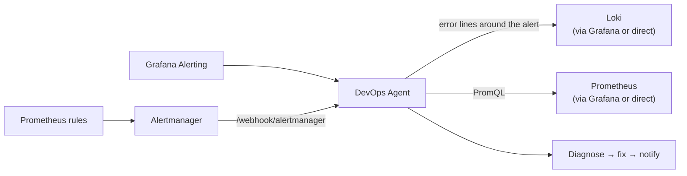

# Grafana, Prometheus and Loki

Connect your monitoring stack so alerts turn into incidents that the agent diagnoses with real metrics
and log lines, then fixes with its normal tools and safety rules.



What happens for each firing alert:

1. Alertmanager or Grafana posts the alert to the agent, which queues it as an incident.
2. Before diagnosing, the agent fetches up to 100 error lines from Loki, starting 15 minutes before the
   alert fired. They're attached to the incident as `alert_logs`.
3. The agent reads those logs first. If it needs more, it calls `query_logs` (LogQL) and `query_metrics`
   (PromQL).
4. It applies a fix with its usual tools: rollback, restart, config PR, scaling and so on. Every change
   follows the same `AUTO_APPLY`, approval and emergency-stop rules as other incidents. Then it reports
   to Slack, quoting the log lines behind the root cause.

You can use either alert source or both. Logs are optional, but without them the agent only has the alert
text, plus whatever its other tools can collect.

## Before you start

- The agent is running and reachable from Alertmanager or Grafana.
- `WEBHOOK_SECRET` is set on the agent. Both endpoints reject unauthenticated requests when it's set.
- For logs: a Loki datasource in Grafana, or a Loki URL the agent can reach.

## Step 1: Configure the agent

Add these to the agent's `.env` (or Kubernetes secret):

```bash
# Shared secret; Alertmanager and Grafana send it as a bearer token
WEBHOOK_SECRET=<long random string>

# Logs and metrics through Grafana (recommended)
GRAFANA_URL=https://grafana.yourcompany.com
GRAFANA_TOKEN=glsa_xxxxxxxx              # service-account token, Viewer role
GRAFANA_LOKI_DATASOURCE_UID=<loki uid>   # turns on log fetching
GRAFANA_DATASOURCE_UID=<prometheus uid>  # used by query_metrics provider=grafana

# Or talk to Loki / Prometheus directly instead
# LOKI_URL=http://loki.monitoring.svc:3100
# LOKI_TOKEN=
# PROMETHEUS_URL=http://prometheus.monitoring.svc:9090
```

If both `GRAFANA_LOKI_DATASOURCE_UID` and `LOKI_URL` are set, Grafana is used.

**Finding the datasource UIDs:** in Grafana, open **Connections → Data sources**, click the Loki (or
Prometheus) datasource, and copy the last part of the URL:
`/connections/datasources/edit/`**`P8E80F9AEF21F6940`**.

**Creating the token:** **Administration → Users and access → Service accounts → Add service account**
with role **Viewer**, then **Add service account token**. Viewer is enough because the agent only reads.

Restart the agent after changing the environment.

## Step 2a: Send alerts from Prometheus Alertmanager

Add a receiver to `alertmanager.yml` and route alerts to it:

```yaml
route:
  receiver: devops-agent
  # or add a child route that matches only the alerts you want handled

receivers:
  - name: devops-agent
    webhook_configs:
      - url: https://devops-agent.yourcompany.com/webhook/alertmanager
        send_resolved: false
        http_config:
          authorization:
            type: Bearer
            credentials: <WEBHOOK_SECRET>
```

Alertmanager can't sign request bodies, so it authenticates with the bearer token above. Without
`http_config.authorization`, the agent returns **401**.

## Step 2b: Send alerts from Grafana Alerting

1. **Alerting → Contact points → + Add contact point**
2. Integration: **Webhook**
3. URL: `https://devops-agent.yourcompany.com/webhook/grafana`
4. **Optional Webhook settings → Authorization Header**: scheme `Bearer`, credentials `<WEBHOOK_SECRET>`
5. Save, then **Alerting → Notification policies** and route the alerts you want handled to this contact
   point (for example, match `team=platform`).

Grafana incidents also carry the dashboard, panel and runbook links from the alert, so the agent's
Slack report links back to where the problem shows up.

## Step 3: Test it

Send a test alert with curl. You should get `{"status": "queued", ...}`:

```bash
curl -X POST https://devops-agent.yourcompany.com/webhook/grafana \
  -H "Authorization: Bearer $WEBHOOK_SECRET" \
  -H "Content-Type: application/json" \
  -d '{
    "alerts": [{
      "status": "firing",
      "labels": {"alertname": "HighErrorRate", "namespace": "prod", "pod": "api-7d9f", "severity": "critical"},
      "annotations": {"summary": "5xx rate above 5%"},
      "startsAt": "'"$(date -u +%Y-%m-%dT%H:%M:%SZ)"'"
    }]
  }'
```

The same body works on `/webhook/alertmanager`. In Grafana you can also click **Test** on the contact
point.

To check that the agent can read logs, run the same query it will run, through Grafana:

```bash
curl -G "$GRAFANA_URL/api/datasources/proxy/uid/$GRAFANA_LOKI_DATASOURCE_UID/loki/api/v1/query_range" \
  -H "Authorization: Bearer $GRAFANA_TOKEN" \
  --data-urlencode 'query={namespace="prod", pod="api-7d9f"} |~ "(?i)error"' \
  --data-urlencode 'limit=5'
```

A `"status":"success"` response means log fetching will work.

## How the agent picks which logs to read

The agent builds a Loki stream selector from the alert's labels, using the first combination the alert
has:

| Alert labels present | Selector used |
|---|---|
| `namespace` + `pod` | `{namespace="…", pod="…"}` |
| `namespace` + `container` | `{namespace="…", container="…"}` |
| `namespace` + `app` | `{namespace="…", app="…"}` |
| `job` | `{job="…"}` |
| `app` | `{app="…"}` |
| `service_name` | `{service_name="…"}` |
| `service` | `{service="…"}` |
| `host` | `{host="…"}` |

It then keeps only lines that look like errors (`error`, `exception`, `fatal`, `panic`, `fail`,
`timeout`, `refused`, `oom`, case-insensitive). If none of those labels exist, no logs are attached.

**Choose the query yourself** when your Loki labels differ from your alert labels. Add a `logql`
annotation to the alert rule and the agent uses it exactly as written.

Prometheus rule:

```yaml
- alert: CheckoutErrors
  expr: sum(rate(http_requests_total{service="checkout",code=~"5.."}[5m])) > 1
  labels:
    severity: critical
  annotations:
    summary: Checkout is returning 5xx
    logql: '{app="checkout", env="prod"} |= "level=error"'
```

In a Grafana alert rule, add the same annotation under **Configure notification message → Add custom
annotation**, with name `logql`.

**Time window:** from 15 minutes before `startsAt` until now, never more than 24 hours.

## What the agent can do with logs and metrics

| Tool | Use |
|---|---|
| `query_logs` | Any LogQL query: widen the window (`since_minutes`, up to 1440), drop the error filter, look at upstream services. Read-only. |
| `query_metrics` | PromQL against Prometheus (`provider=prometheus`) or through Grafana (`provider=grafana`). |
| `evaluate_slo` | Availability and error budget from good/total queries. |
| `capacity_check` | CPU, memory and disk usage against thresholds. |

The fix itself depends on what the alert is about. A pod alert is handled as a Kubernetes incident
(rollback, resource changes), a server alert as a Linux/nginx incident, and so on. The alert's name and
labels decide which.

## Multiple organizations

Add an `org_id` label to the alert, or send an `X-Org-ID` header, to scope the incident to that
organization's credentials and docs. Grafana's own numeric `orgId` is ignored.

## Troubleshooting

| Symptom | Cause and fix |
|---|---|
| `401 Invalid signature` | The bearer token doesn't match `WEBHOOK_SECRET`, or Alertmanager is missing `http_config.authorization`. Check that the scheme is `Bearer`, not `Basic`. |
| `{"status": "queued", "incident_ids": []}` | All alerts in the payload were `resolved`. Only firing alerts are handled. |
| `{"status": "duplicate", ..., "duplicate_of": [...]}` | A repeat notification of an alert already being handled (same fingerprint and `startsAt` within `ALERT_DEDUPE_WINDOW_SEC`, default 1 hour). This is expected; Alertmanager and Grafana re-send firing alerts. |
| Incident has no `alert_logs` | `GRAFANA_LOKI_DATASOURCE_UID` / `LOKI_URL` not set, or the alert has none of the labels in the table above. Add a `logql` annotation. |
| `alert_logs` contains `403 from …` | The Grafana token lacks access to the Loki datasource. Give the service account Viewer role (and datasource permission if you use datasource RBAC). |
| `alert_logs` contains `400 from …` | Invalid LogQL in the `logql` annotation. Try it in Grafana **Explore** first. |
| `alert_logs` has `line_count: 0` | The selector matched nothing, or there were no error lines. Check the label names in Explore, or use a `logql` annotation without the error filter. |
| Logs are found but the agent doesn't change anything | `AUTO_APPLY=false` (the default) means changes wait for approval in Slack. See [Safety guarantees](../SECURITY_GUARANTEES.md). |

## Reference

| Variable | Purpose |
|---|---|
| `WEBHOOK_SECRET` | Bearer token (or HMAC key) for `/webhook/alertmanager` and `/webhook/grafana` |
| `GRAFANA_URL` | Grafana base URL |
| `GRAFANA_TOKEN` | Service-account token (Viewer) |
| `GRAFANA_LOKI_DATASOURCE_UID` | Loki datasource UID; turns on log fetching through Grafana |
| `GRAFANA_DATASOURCE_UID` | Prometheus datasource UID for `query_metrics provider=grafana` (default `prometheus`) |
| `LOKI_URL`, `LOKI_TOKEN` | Query Loki directly instead of through Grafana |
| `PROMETHEUS_URL`, `PROMETHEUS_TOKEN` | Query Prometheus directly |

Endpoint details: [API reference](API_REFERENCE.md).
