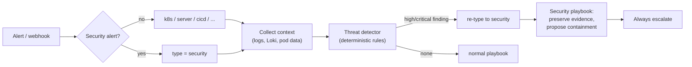

# Threat detection

The agent recognises **active attacks** and handles them differently from outages. A crypto miner
usually shows up first as a "high CPU" alert, and a compromised container as a "pod restarting" alert.
Without this, the agent would treat them like ordinary outages: restart the pod, raise a limit, and
call it resolved.

## What happens to an incident

1. **Classification.** Security alerts are recognised before any other type, from the alert name
   (Falco rules, GuardDuty, "brute force", "cryptominer", "reverse shell", "privilege escalation",
   "unauthorized access", …), the alert source label (`falco`, `guardduty`, `scc`, `defender`, `wazuh`,
   `crowdstrike`, …), or labels such as `security="true"`, `category="security"` and `mitre_technique`.
2. **Detection on every incident.** After the agent collects context (alert text, raw logs, Loki
   `alert_logs`, pod and CI logs), the threat detector scans it. Findings are attached as
   `threat_findings`.
3. **Re-typing.** If a finding is **high or critical**, the incident switches to the `security`
   playbook, whatever type it arrived as. The original type is kept in `original_type`.
4. **Security playbook.** The agent treats log and alert content as attacker-controlled data:
   - It confirms each finding with read-only tools and scopes what's affected.
   - It **never deletes or restarts** the affected workload, because that destroys evidence.
   - It proposes containment only through `suggest_fix`, each step with its rollback.
5. **Escalation.** Security incidents are never marked resolved by the agent and are always
   escalated. Critical findings escalate at **critical** priority.

## What the detector looks for

The detector is rule-based and runs **without the LLM**, so a prompt-injected log line can't talk it
out of a finding.

| Rule | Example evidence | MITRE ATT&CK | Severity |
|---|---|---|---|
| `crypto_mining` | `xmrig`, `stratum+tcp://`, pool hosts, `--donate-level`, `kinsing` | T1496 | critical |
| `reverse_shell` | `bash -i >& /dev/tcp/…`, `nc … -e /bin/sh`, socket-spawned Python/Perl shells, `mkfifo … \| sh` | T1059 | critical |
| `brute_force_success` | ≥ threshold failed logins from one IP, **then a successful login from it** | T1110 | critical |
| `brute_force` | ≥ `THREAT_BRUTE_FORCE_THRESHOLD` (default 10) failed logins from one IP | T1110 | high |
| `container_shell` | Falco "Terminal shell in container", `pods/exec`, `kubectl exec -it` | T1609 | high |
| `privileged_workload` | Falco "Launch Privileged Container", "Create HostNetwork Pod", `nsenter --target 1` | T1611 | high |
| `credential_access` | reading `/etc/shadow`, `.aws/credentials`, service-account tokens, SSH keys, kubeconfig | T1552 | high |
| `download_execute` | `curl … \| sh`, `wget -qO- … \| bash` | T1105 | high |
| `defense_evasion` | `history -c`, `unset HISTFILE`, shredding shell history or `/var/log` | T1070 | high |
| `cloud_threat_finding` | GuardDuty-style types such as `UnauthorizedAccess:IAMUser/…`; `CryptoCurrency:`/`Backdoor:`/`Trojan:` are critical | T1078 | high/critical |

Each finding includes up to five evidence lines (PII-scrubbed and truncated), extracted source IPs,
the MITRE technique and tactic, and a count. Ordinary operational text (OOM kills, image pull errors,
health checks, `journalctl --vacuum`, non-interactive `kubectl exec`, a single successful SSH login)
doesn't trigger findings.

The agent can also call **`detect_threats`** (read-only) on any log text it fetches, for example
output from `query_logs` or `get_k8s_context`.

## Configuration

| Variable | Default | Effect |
|---|---|---|
| `ESCALATION_ON_SECURITY` | `true` | Always escalate security incidents (critical findings at critical priority) |
| `THREAT_BRUTE_FORCE_THRESHOLD` | `10` | Failed logins from one source IP before brute force is reported |

Metric: `devops_agent_threat_findings_total{technique,severity}` (see
[Monitoring the agent](GRAFANA_PROMETHEUS.md#monitoring-the-agent-itself)).

## Not yet included

- Native webhooks for Falco, GuardDuty, GCP Security Command Center and Defender for Cloud (#167)
- Approval-gated containment actions: isolate pod, cordon node, disable key, block IP (#168)
- Kubernetes audit log and CloudTrail detections (#169)

Until then, route security tools through Alertmanager or Grafana with a `source` or `category` label,
or post to `/webhook/manual` with `"type": "security"`.
